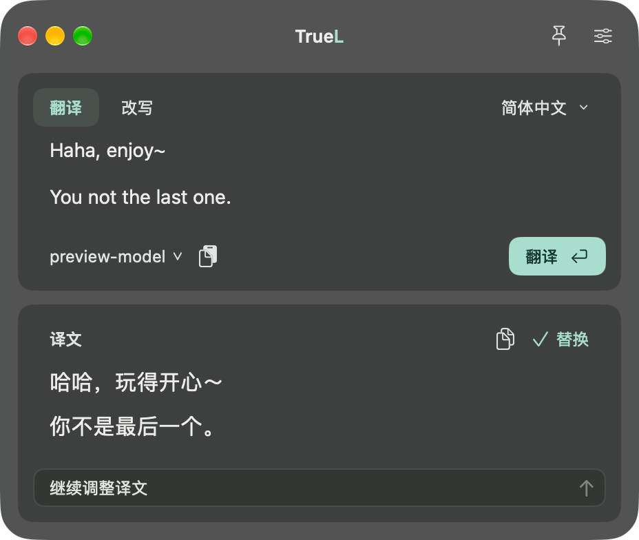

# TrueL

读懂，再表达。一个轻巧的 macOS 翻译与改写工具。

[下载安装包](https://github.com/yangbo-s/TrueL/releases/latest) · [使用指南](docs/USAGE.md) · [更新记录](CHANGELOG.md)



- 在一个浮窗里翻译、改写、查看修改解释，并继续调整措辞。
- 直接处理所选文字或剪贴板，复制结果或替换原文。
- 翻译与改写分别选择模型；主浮窗可以随时切换具体模型。
- 支持 GPT、Claude、Gemini、Grok、DeepSeek、Kimi、GLM，自带 API Key。
- 原生毛玻璃、深浅色外观、窗口置顶和自适应尺寸。
- 六款应用图标可选，默认 3A，在设置中即时切换 Dock 图标。
- 可录制连续快捷键，通过应用内更新获取新版。

## 安装

需要 **macOS 26 或更新版本、Apple silicon Mac**。

下载 DMG，打开后将 TrueL 拖入 Applications。若首次打开被系统拦截，在「系统设置 → 隐私与安全性」中选择「仍要打开」。

## 开始使用

1. 打开「设置 → AI 服务」，选择模型系列，填写 API Key 并保存。
2. 分别选择「翻译模型」和「改写模型」，点击各自的保存按钮。
3. 输入或粘贴文字，按 **Return 提交**；**Shift + Return 换行**。

默认按 **⌘C、⌘C** 翻译选中文字；可以在「快捷键」页修改。跨应用取词和替换需要辅助功能权限，连续快捷键需要输入监控权限。

API Key 保存在 macOS 钥匙串。提交的文字会发送给所选模型的服务商。

升级后若显示凭据需要授权，在「AI 服务」点击「读取已存 Key」，按系统提示完成首次迁移即可。

## 开发

使用 Swift 6.2、SwiftUI、AppKit 和 Sparkle。

```sh
./tools/test.sh
./build.sh
./tools/package-dmg.sh --skip-build
```

构建签名配置见[开发指南](docs/DEVELOPMENT.md)，更新包发布见[发布指南](docs/RELEASING.md)。
