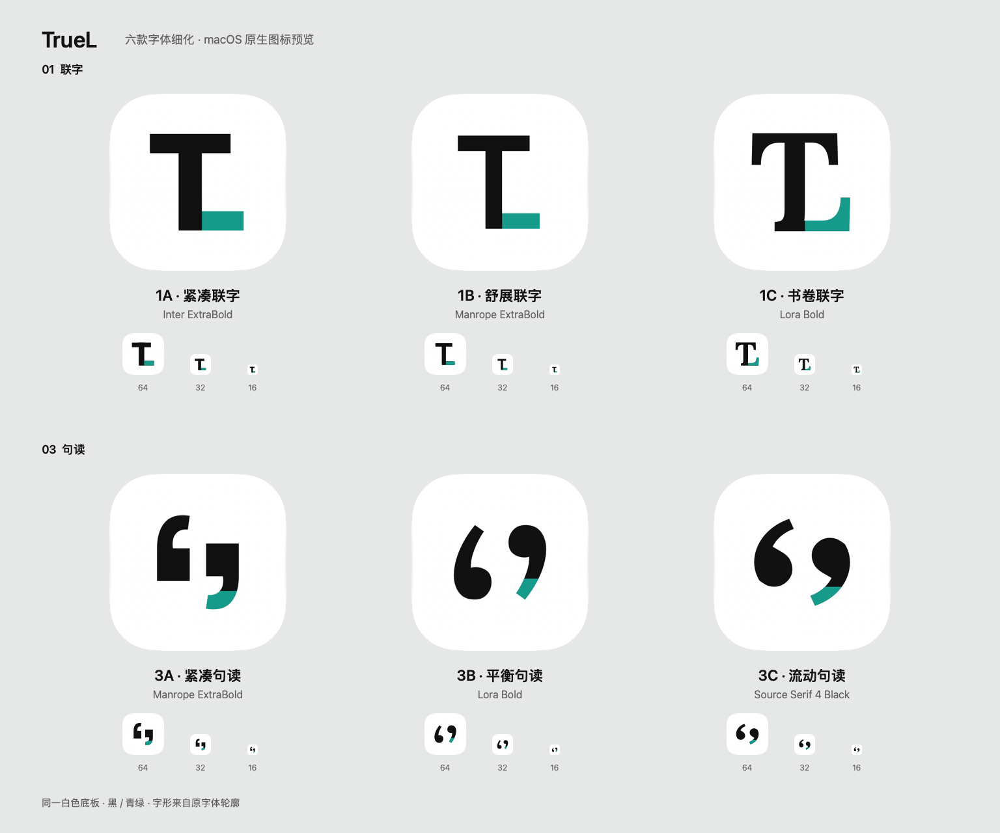

# TrueL 图标细化

保留联字与句读两个方向，每组各三款。白色底板一致，比较字体骨架、比例与排布。



| 编号 | 方案 | 字形基底 | 白底 SVG |
| --- | --- | --- | --- |
| 1A | 紧凑联字 | Inter ExtraBold | [1A.svg](1A.svg) |
| 1B | 舒展联字 | Manrope ExtraBold | [1B.svg](1B.svg) |
| 1C | 书卷联字 | Lora Bold | [1C.svg](1C.svg) |
| 3A | 紧凑句读 | Manrope ExtraBold | [3A.svg](3A.svg) |
| 3B | 平衡句读 | Lora Bold | [3B.svg](3B.svg) |
| 3C | 流动句读 | Source Serif 4 Black | [3C.svg](3C.svg) |

`renders/` 是 Apple Icon Composer 输出的 macOS 原生图标效果，包括 512、64、32、16 像素。`native/<编号>/AppIcon.icon` 可在 Icon Composer 中继续调整；带白底的 SVG 和 `-mark.svg` 透明标志均已转曲，不依赖本机安装字体。

- 联字使用字体的 T 与 L，按真实竖笔轴线组合。1B 的 L 略微下移；1C 在笔画重合的直段拼接 T 上半与 L 下半，保留原字体曲线，去掉两字叠加造成的凸台。
- 3A 使用 Manrope 的右引号字形，左侧旋转 180°，保持现成轮廓；3B 使用 Lora 的左右引号并列；3C 使用 Source Serif 4 的左右引号错位。
- 青绿只通过裁色作用于原轮廓。黑色 `#111111`、白色 `#FFFFFF`、青绿 `#169B8B`。

六款全部作为可选样式保留，TrueL 默认使用 3A。

## 字体来源与重生成

使用 Google Fonts 仓库中的 [Inter](https://github.com/google/fonts/tree/main/ofl/inter)、[Manrope](https://github.com/google/fonts/tree/main/ofl/manrope)、[Lora](https://github.com/google/fonts/tree/main/ofl/lora)、[Source Serif 4](https://github.com/google/fonts/tree/main/ofl/sourceserif4) 版本。TTF、原始 OFL 许可及来源 URL / SHA-256 保存在 `fonts/`；导出的原字形保存在 `glyphs.json`。

在项目根目录运行：

```sh
swift -module-cache-path .build/modules design/logo-refinements/tools/extract-glyphs.swift design/logo-refinements/fonts
swift -module-cache-path .build/modules design/logo-refinements/tools/join-lora.swift design/logo-refinements
python3 design/logo-refinements/tools/build.py
python3 design/logo-refinements/tools/render.py
swift -module-cache-path .build/modules design/logo-refinements/tools/contact-sheet.swift design/logo-refinements
```

已核对六款大图与 64/32/16 像素效果。3A 的左引号已修正并复核。1C 已合为一个闭合轮廓，拼接处切线连续；1,974,000 个轮廓采样点与所保留的原字形一致。其余五款的 45 个文件逐字节保持不变。应用内的「设置 → 图标」可切换这六款样式；生产资源由 `tools/make-icons.py` 从原生母版生成。
