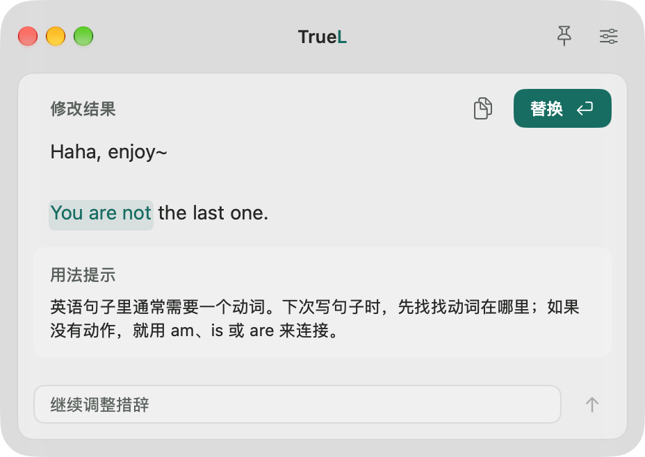

# 使用指南

## 配置 API 与模型

进入「设置 → AI 服务」，选择模型系列，粘贴 API Key，点击 Key 下方的「保存」。验证成功后，分别在「翻译模型」和「改写模型」中选定具体模型，并点击该行「保存」。两项可以来自不同系列，也可以使用同一个模型。

主浮窗左下角显示当前任务的模型 ID。菜单按系列列出已验证账号的可用模型，选中后立即保存。切换翻译和改写会恢复各自的选择；「管理模型…」进入服务设置。Key 验证失败时会显示错误，原有已保存配置保留。

GPT、Claude、Gemini、Grok、DeepSeek 和 Kimi 从 API 读取文本模型目录。GLM 使用应用内官方模型目录，保存 Key 时发送一个简短验证请求；具体模型的调用权限由账号决定。

从旧版升级后，若出现「读取已存 Key」，点击它并按 macOS 提示授权。已有 Key 会迁移到固定凭据组件管理的钥匙串条目，原条目保留。多个模型系列分别恢复；取消后可以再次点击，无需重新输入 Key。此后普通版本更新沿用同一凭据组件。

## 输入与结果

- Return 或数字键盘 Enter：提交。
- Shift + Return：插入换行。
- 中文等输入法组词时，Return 先确认候选，不会提交请求。
- 打开翻译/改写：左侧输入原文，右侧显示结果，两栏各自滚动。修改原文或切换任务会清除旧结果。
- 结果下方可输入追加要求，再按 Return 调整措辞。

翻译支持目标语言，改写支持风格与修改解释。点击已修改片段可以查看解释，复制获得完整正文。快速翻译和快速改写只显示结果岛，加载与错误也在同一处显示。结果就绪后，绿色「替换 ↩」对应 Return；点入调整框后，绿色按钮移至调整输入行，Return 仅提交调整。空的调整框不会触发替换；调整完成后回到结果，Return 再次对应替换。

替换前会核对来源应用、原控件、选区范围与文字。不可编辑的网页选区可复制结果；替换按钮禁用。选区变化或来源关闭时不会写入。

## 快捷键与窗口

| 动作 | 默认快捷键 |
| --- | --- |
| 快速翻译 | ⌃C、C（Ctrl+C+C） |
| 翻译剪贴板 | ⌃⌥⌘1 |
| 打开翻译 | ⌃⌥⌘2 |
| 打开改写 | ⌃⌥⌘3 |
| 快速改写 | ⌃A、A（Ctrl+A+A） |

在快捷键设置中录制组合键或连续按键。连续按键的间隔为 1 秒；可配置 Ctrl+C、C 或 Ctrl+1、2 等序列。冲突会在设置中提示。按住 Control 连按两次字母即可。非复制序列在识别期间保留选区，未完成时会归还原按键；自定义 Command+C 序列保留原生复制。升级会迁移旧默认值，保留其他自定义及已关闭的快捷键。

拖动顶栏移动窗口，拖动边沿调整尺寸。置顶后浮窗保持可见；未置顶时点击外部收起。快速和左右对照共用同一个窗口，各自记住本次运行中的手动尺寸。再次打开保留当前输入。关闭和退出会停止未完成请求。

辅助功能用于跨应用取词与替换，输入监控用于连续快捷键。可在「设置 → 通用」打开对应系统权限页面，授权 `/Applications/TrueL.app`。

## 应用图标

在「设置 → 图标」选择 1A、1B、1C、3A、3B 或 3C，Dock 图标会立即切换，重启后保留选择。默认是 3A；Finder 中的应用图标始终显示 3A。

## 更新

在「设置 → 关于」或应用菜单选择「检查更新…」。自动检查开关也位于关于页；下载安装由 Sparkle 的更新窗口确认。

0.3.0 开始内置更新功能。安装这一版本后，后续版本可以直接在应用内更新。
